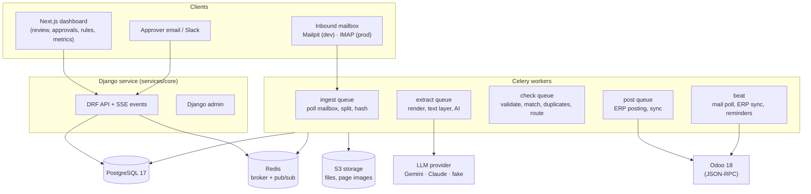
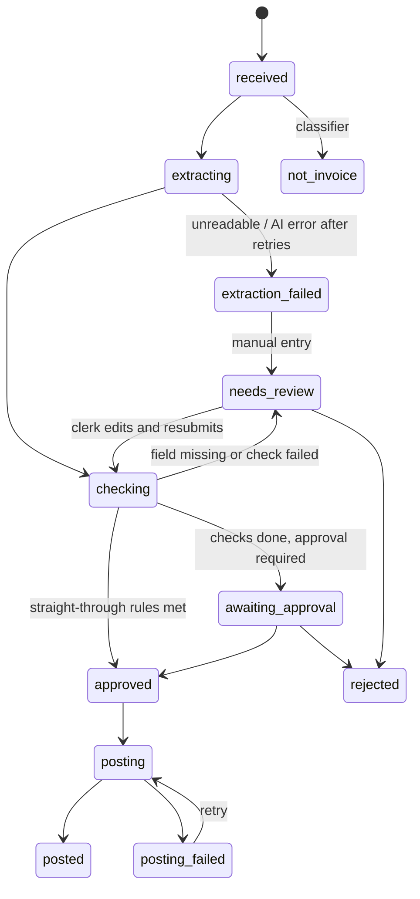

# 03 · Architecture

## Components



| Component | Responsibility |
|---|---|
| **Django API** | Auth, orgs, invoices, review edits, approvals, rules, metrics, audit; SSE stream of invoice events |
| **ingest** | Poll the mailbox, store attachments, file hash dedup, classify "invoice or not", split multi-invoice PDFs |
| **extract** | Render page images, read the text layer, call the LLM with the schema, ground every value, normalise |
| **check** | Validation rules, vendor match, PO/receipt match, duplicate and fraud checks, approval routing |
| **post** | Create the vendor bill in Odoo, attach the file, record the ERP id; retries with idempotency |
| **beat** | Every minute: mailbox poll. Every 15 min: ERP master-data sync (vendors, POs, receipts, accounts, taxes). Daily: approval reminders |
| **Odoo** | The system of record for vendors, purchase orders, receipts and bills (reference ERP; adapter interface for others) |

## Invoice lifecycle (state machine)



- Every transition is written by one function, `transition(invoice, to, *, actor, reason)`. It checks that the move is allowed, saves the new state, writes an audit event and publishes an SSE event. No other code changes `status`.
- Stage tasks are **idempotent**: each one checks the current state first, so a duplicate Celery delivery does nothing.

## Data flow for one invoice

1. **ingest:** the file is saved to S3 as `orgs/<org>/files/<sha256>`, and a `Document` row is created. If the same sha256 was seen before in this org, the new email is linked to the existing document and processing stops.
2. **extract:**
   - Render every page to PNG at 150 dpi using pypdfium2. Photos are de-skewed and resized.
   - Get the text layer with words and their boxes using pdfplumber. Scans have no text layer.
   - Make one LLM call per invoice with the page images, the text layer (when present) and the JSON schema. Optional vendor hints are included.
   - The grounding step looks for each value in the text layer to get its box. When there's no text layer, the model's own quote and page are used and the grounding confidence is lowered.
   - Normalise the values: dates, amounts, currency codes, tax ids.
3. **check:**
   - Run the rule pipeline. Each rule returns a `CheckResult(code, severity, message, evidence)`.
   - Severities are `info`, `warning` and `blocking`.
   - The routing decision is computed from the results, the approval matrix and the straight-through policy.
4. **approve:** create the approval requests, send email and Slack, wait, then record the decision.
5. **post:** the ERP adapter runs `find_bill(vendor, ref)`, then `create_bill(...)` and `attach(file)`. The resulting ERP id is stored.

## Key design decisions

| Decision | Why | ADR |
|---|---|---|
| AI only extracts; rules decide | Predictable, auditable, immune to prompt injection in documents | [0001](adr/0001-ai-extracts-rules-decide.md) |
| Grounded extraction with evidence | Catches hallucinations; gives reviewers instant verification | [0002](adr/0002-grounded-extraction.md) |
| Odoo as the reference ERP, behind an adapter | Free, real ERP with purchase, receipts and accounting; Khurram knows it; adapter keeps others possible | [0003](adr/0003-odoo-reference-erp.md) |
| Reuse the WatchOnce stack (Django, Celery, Next.js, pluggable LLM) | Proven patterns, faster build, consistent portfolio story | [0004](adr/0004-reuse-watchonce-stack.md) |

## Repository layout (planned)

```
invoiceflow/
  apps/web/                 Next.js 16 dashboard
  services/core/            Django project
    config/                 settings, urls, celery, asgi
    accounts/               users, orgs, memberships, roles
    documents/              files, pages, ingestion, mailbox
    invoices/               invoice model, state machine, review API, events
    extraction/             schema, prompts, providers, grounding, normaliser
    checks/                 validation rules, matching, duplicates, fraud, routing
    approvals/              matrix, requests, signed links, Slack
    erp/                    adapter interface, odoo adapter, sync
    audit/                  append-only events
    metrics/                aggregates
  evals/                    generator, dataset, runner, reports
  infra/                    docker-compose (Postgres, Redis, SeaweedFS S3, Mailpit, Odoo), seed scripts
  docs/
```
