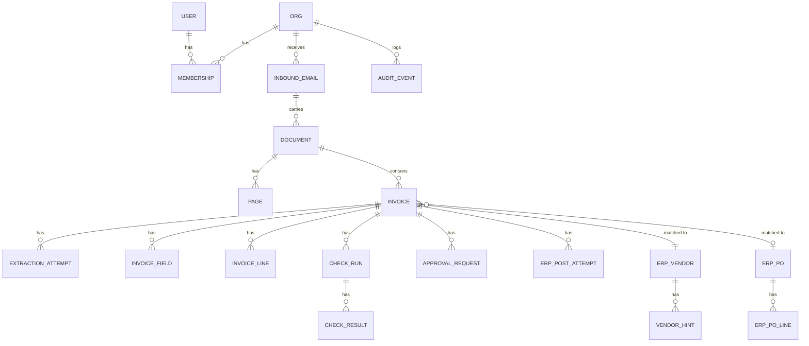

# 10 · Data Model

PostgreSQL. All business tables carry `org_id` and are queried through an org-scoped manager (same pattern as WatchOnce). IDs are prefixed strings (`inv_…`, `doc_…`) for readable logs and URLs. Money is `NUMERIC(18,4)` + a `currency` CHAR(3).

## Tables

### Tenancy and users
| Table | Key columns |
|---|---|
| `org` | id, name, base_currency, locale, date_format, timezone, straight_through_limit, ai_budget_usd, settings (JSON: tolerances, allowed tax rates, post_bills) |
| `user` | id, email, name, password (Django), is_active |
| `membership` | org, user, roles (array: clerk, approver, controller, admin), approval_limit |
| `api_token` | org, user, name, hashed token, last_used_at, expires_at |

### Intake
| Table | Key columns |
|---|---|
| `inbound_email` | org, message_id (unique per org), from_addr, subject, received_at, raw_size |
| `document` | org, sha256 (unique per org), filename, mime, size, page_count, has_text_layer, source (upload/email/api), inbound_email, uploaded_by, storage_key, status (ok / not_invoice / rejected), reject_reason |
| `page` | document, number, image_key, width, height, words (JSONB: text + bbox, compressed) |

### Invoices
| Table | Key columns |
|---|---|
| `invoice` | org, document, page_from, page_to, **status** (state machine), document_type, vendor (FK erp_vendor, null), po (FK erp_po, null), invoice_number, invoice_number_norm, invoice_date, due_date, currency, subtotal, tax_total, total, total_in_base, bank_account_enc, trust_summary, decision (JSON), rules_version, erp_bill_id, erp_url, created_at, updated_at |
| `invoice_field` | invoice, name, value (JSON), raw_quote, page, bbox, grounding (exact/fuzzy/model_only/none), trust (high/medium/low), source (ai/user), edited_by, edited_at |
| `invoice_line` | invoice, position, description, product_code, quantity, unit, unit_price, discount_pct, tax_rate_pct, line_total, po_line (FK), account (FK erp_account), evidence (JSON per field) |
| `extraction_attempt` | invoice, provider, model, prompt_version, input_tokens, output_tokens, cost_usd, latency_ms, raw_output (JSONB), error |
| `check_run` | invoice, rules_version, started_at, decision, actor |
| `check_result` | check_run, code, severity, message, fields (array), data (JSONB), overridden_by, override_reason |
| `duplicate_link` | invoice, other_invoice or erp_bill_ref, kind (exact/file/fuzzy), resolved (not_duplicate / confirmed), resolved_by, reason |

### Approvals
| Table | Key columns |
|---|---|
| `approval_rule` | org, position, conditions (JSON), approvers (JSON: users/roles/po_requester), steps |
| `approval_request` | invoice, step, approver (user), status (pending/approved/rejected/expired/escalated), decided_at, reason, channel (app/email/slack), token_hash, expires_at, ip, user_agent |

### ERP mirror
| Table | Key columns |
|---|---|
| `erp_connection` | org, kind (odoo/fake/csv), url, db, username, api_key_enc, last_sync_at, status |
| `erp_vendor` | org, erp_id, name, tax_id, emails (array), domains (array), bank_accounts_enc (array), currency, non_po (bool), created_in_erp_at, category |
| `erp_po` / `erp_po_line` | org, erp_id, number, vendor, state, currency, requester, department; lines: product_code, description, qty_ordered, qty_received, qty_invoiced, unit_price, tax |
| `erp_account`, `erp_tax` | org, erp_id, code, name, rate |
| `erp_bill_ref` | org, erp_id, vendor, ref, ref_norm, total, date, state |
| `erp_post_attempt` | invoice, step (search/create/attach/post), status, erp_id, error, at |
| `vendor_hint` | vendor, text, proposed_by, confirmed_by, active |

### Audit and metrics
| Table | Key columns |
|---|---|
| `audit_event` | org, at, actor (user / system / approver-link), action (`invoice.field_edited`, `invoice.transition`, `approval.decided`, `erp.posted`, …), target, before, after, ip. **Insert-only**: no UPDATE or DELETE grants for the app role; a Postgres trigger rejects changes |
| `ai_usage_daily` | org, date, provider, calls, cost_usd |

## Indexes worth noting

- `invoice (org, status, created_at desc)`: inbox and queues.
- `invoice (org, vendor, invoice_number_norm)`: exact duplicate check.
- `invoice (org, vendor, total, invoice_date)`: fuzzy duplicate check.
- `erp_vendor` GIN trigram on `name`: vendor fuzzy match.
- `audit_event (org, target, at)`: invoice history.
